# Demokršćanstvo: od riječi do argumenta

Politička pripadnost, vrijednosti i javne odluke

DigiKat | Hrvatsko katoličko sveučilište | 19. rujna 2026.

Autor: [Luka Šikić](https://www.lukasikic.info/)

# Političko ime dobiva značenje u konkretnim odlukama

Demokršćanstvo u analiziranim medijskim tekstovima služi predstavljanju političke pripadnosti, obrazlaganju vrijednosti i raspravi o javnim pitanjima. Iza zajedničkog naziva pojavljuju se različite predodžbe o tome tko pripada toj tradiciji i što iz nje slijedi.

## Stranke i vrijednosti u središtu su rječnika

Riječ **vrijednost** pojavljuje se u **1.123** različita teksta, a **HDZ** u **818**. Rasprava često spaja ime političke tradicije s predstavljanjem stranke i njezinih načela. Ti izrazi otvaraju pitanje odgovara li djelovanje aktera identitetu na koji se pozivaju.

## Desni centar povezuje položaj, nasljeđe i suradnju

Izraz **desni centar** nalazi se u **208** tekstova. Uz njega se u tematskim skupinama ističu narodnjaštvo, domoljublje i stranka. Takav rječnik smješta demokršćanstvo u politički prostor u kojem se određuju vlastita pozicija i mogući partneri.

## Poštovanje načela može pratiti odbijanje stranačke pripadnosti

Samir Haj Barakat pri izlasku iz SDP-a u kolovozu 2024. naglašava da poštuje demokršćanska načela, ali odbija prelazak u HDZ i zadržava lijeva uvjerenja. Njegov primjer pokazuje zašto odnos prema tradiciji treba razlikovati od odnosa prema pojedinoj stranci.

## Načela se pretvaraju u argumente o savjesti i razvoju

Andrej Plenković demokršćanskim vrijednostima obrazlaže protivljenje zabrani priziva savjesti. Davor Ivo Stier solidarnost povezuje s europskim fondovima, željeznicom i zaštitom od poplava. U tim iskazima politički naziv dobiva prepoznatljivu posljedicu za javne odluke.

> Ključno pitanje rasprave glasi: što pozivanje na demokršćanstvo znači za političko djelovanje?

Brojevi označuju tekstove u kojima je riječ ili izraz pronađen u rečenicama o temi. Podaci i oblak riječi: str. 3; tematska karta: str. 4-7; izrazi: str. 8; konkretni primjeri: str. 9-12.

# Koje riječi prate demokršćanstvo?

Analiza obuhvaća **2.253 različita teksta i objave**, izdvojena iz 2.306 zapisa medijskog praćenja projekta DigiKat za razdoblje **1. 1. 2021. - 10. 9. 2026.** Pretežu mrežni članci; uključeni su i društvene mreže, komentari, tisak te drugi mediji. Odabrani su tekstovi koji spominju demokršćanstvo ili povezuju kršćanske društvene ideje s javnim pitanjima.

Prebrojene su riječi u rečenicama povezanima s temom. Jednaki tekstovi broje se jednom, a riječ najviše jednom po tekstu. Gramatički oblici objedinjeni su pod osnovnim oblikom: primjerice, *vrijednosti* pod *vrijednost*. Brojevi opisuju odabrani medijski materijal; nisu mjera potpore građana.

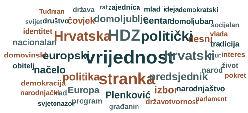

Veća riječ znači da se pojavljuje u više tekstova. Prikazano je 48 čestih imenica, pridjeva i imena. Izostavljene su opće povezne riječi te nazivi demokršćanstva i kršćanstva kako bi se vidio njihov kontekst. Položaj i boja riječi nemaju dodatno značenje.

| Riječ | Broj tekstova | Udio od 2.253 |
|---|---:|---:|
| vrijednost | 1.123 | 49,8% |
| stranka | 830 | 36,8% |
| HDZ | 818 | 36,3% |

Rječnik povezuje vrijednosti sa strankama, političkim položajem i Hrvatskom. Europa, obitelj, narodnjaštvo i domoljublje pokazuju smjerove u kojima se taj opći govor sadržajno razvija.

# O čemu se najviše govori?

Najveća skupina tekstova govori o političkoj pripadnosti i idejama. Slijede vrijednosti i svjetonazorski prijepori te HDZ i demokršćanski identitet. U tim se područjima susreću političko predstavljanje i očekivanja prema javnom djelovanju.

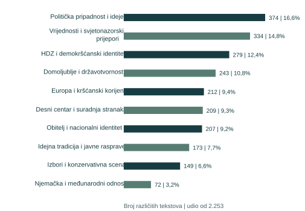

Svaki je tekst prema sličnosti sadržaja računalno pridružen jednoj glavnoj tematskoj skupini. Stupci prikazuju broj tekstova i udio među svih 2.253. Jedan tekst ostao je izvan deset skupina. Tema opisuje sadržaj teksta; ne označuje slaganje s demokršćanstvom.

Četiri skupine o političkoj pripadnosti, HDZ-u, domoljublju i desnom centru zajedno okupljaju **1.105 tekstova (49,0%)**. Preostale teme otvaraju obitelj, Europu, izbore, idejnu tradiciju i međunarodne odnose. Demokršćanstvo se tako pojavljuje i kao politička oznaka i kao okvir za tumačenje društva.

# Kako se gradi politički identitet?

Oblaci pokazuju rječnik unutar pojedine tematske skupine. Iste riječi povezuju više skupina, ali se mijenja njihov naglasak: od stranke i načela do nasljeđa, HDZ-a i položaja na desnom centru.

## Politička pripadnost i ideje

374 tekstova u skupini.

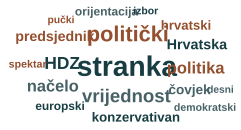

Stranka i politička orijentacija stavljaju u prvi plan pitanje pripadnosti.

| Riječ | Broj tekstova | Udio u skupini |

|---|---:|---:|

| stranka | 299 | 79,9% |

| politički | 177 | 47,3% |

| vrijednost | 130 | 34,8% |

| HDZ | 113 | 30,2% |

| politika | 102 | 27,3% |

| načelo | 101 | 27,0% |

| Hrvatska | 77 | 20,6% |

| predsjednik | 75 | 20,1% |

| čovjek | 69 | 18,4% |

| konzervativan | 66 | 17,6% |

| hrvatski | 65 | 17,4% |

| orijentacija | 54 | 14,4% |

| europski | 53 | 14,2% |

| spektar | 43 | 11,5% |

| demokratski | 42 | 11,2% |

| izbor | 41 | 11,0% |

| pučki | 40 | 10,7% |

| desni | 39 | 10,4% |

## Domoljublje i državotvornost

243 tekstova u skupini.

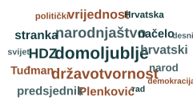

Domoljublje, državotvornost i narodnjaštvo čine prepoznatljiv jezik političkog nasljeđa.

| Riječ | Broj tekstova | Udio u skupini |

|---|---:|---:|

| domoljublje | 209 | 86,0% |

| državotvornost | 163 | 67,1% |

| narodnjaštvo | 155 | 63,8% |

| HDZ | 144 | 59,3% |

| vrijednost | 123 | 50,6% |

| hrvatski | 114 | 46,9% |

| stranka | 111 | 45,7% |

| Plenković | 106 | 43,6% |

| predsjednik | 104 | 42,8% |

| načelo | 99 | 40,7% |

| Tuđman | 95 | 39,1% |

| narod | 83 | 34,2% |

| Hrvatska | 66 | 27,2% |

| politički | 59 | 24,3% |

| svijet | 55 | 22,6% |

| rad | 52 | 21,4% |

| demokracija | 49 | 20,2% |

| desni | 46 | 18,9% |

## HDZ i demokršćanski identitet

279 tekstova u skupini.

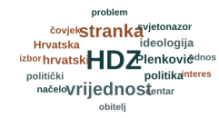

Ime HDZ-a povezuje se s vrijednostima, ideologijom i svjetonazorom.

| Riječ | Broj tekstova | Udio u skupini |

|---|---:|---:|

| HDZ | 255 | 91,4% |

| stranka | 115 | 41,2% |

| vrijednost | 112 | 40,1% |

| Plenković | 53 | 19,0% |

| hrvatski | 51 | 18,3% |

| ideologija | 46 | 16,5% |

| politika | 43 | 15,4% |

| Hrvatska | 41 | 14,7% |

| politički | 34 | 12,2% |

| svjetonazor | 33 | 11,8% |

| čovjek | 33 | 11,8% |

| centar | 32 | 11,5% |

| načelo | 31 | 11,1% |

| izbor | 26 | 9,3% |

| obitelj | 26 | 9,3% |

| problem | 25 | 9,0% |

| interes | 22 | 7,9% |

| odnos | 22 | 7,9% |

## Desni centar i suradnja stranaka

209 tekstova u skupini.

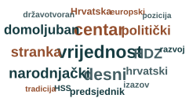

Desni centar označuje položaj, uz narodnjačke i domoljubne odrednice.

| Riječ | Broj tekstova | Udio u skupini |

|---|---:|---:|

| vrijednost | 170 | 81,3% |

| centar | 152 | 72,7% |

| desni | 146 | 69,9% |

| narodnjački | 112 | 53,6% |

| stranka | 108 | 51,7% |

| HDZ | 104 | 49,8% |

| domoljuban | 95 | 45,5% |

| politički | 92 | 44,0% |

| hrvatski | 64 | 30,6% |

| predsjednik | 51 | 24,4% |

| Hrvatska | 50 | 23,9% |

| izazov | 40 | 19,1% |

| razvoj | 40 | 19,1% |

| europski | 37 | 17,7% |

| državotvoran | 36 | 17,2% |

| HSS | 36 | 17,2% |

| tradicija | 34 | 16,3% |

| pozicija | 33 | 15,8% |

U svakom je oblaku 18 čestih riječi. Veća riječ pojavljuje se u više tekstova unutar te skupine; veličine slova uspoređuju se samo unutar jednog oblaka. Ispod su navedeni brojevi tekstova za tri najčešće prikazane riječi. Boja i razmak ne označuju povezanost riječi.

# Koji sadržaji prate govor o vrijednostima?

Vrijednosti se susreću s obitelji i nacionalnim identitetom, europskim pitanjima i razgovorima o idejnoj tradiciji. Oblaci otkrivaju različite kontekste u kojima ista politička oznaka dobiva sadržaj.

## Obitelj i nacionalni identitet

207 tekstova u skupini.

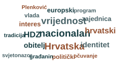

Obitelj je dio rječnika nacionalnog identiteta, interesa i zajednice.

| Riječ | Broj tekstova | Udio u skupini |

|---|---:|---:|

| nacionalan | 118 | 57,0% |

| Hrvatska | 110 | 53,1% |

| vrijednost | 110 | 53,1% |

| HDZ | 83 | 40,1% |

| hrvatski | 80 | 38,6% |

| identitet | 68 | 32,9% |

| obitelj | 64 | 30,9% |

| interes | 54 | 26,1% |

| zajednica | 53 | 25,6% |

| europski | 52 | 25,1% |

| politički | 46 | 22,2% |

| vlada | 42 | 20,3% |

| građanin | 39 | 18,8% |

| očuvanje | 37 | 17,9% |

| program | 37 | 17,9% |

| tradicija | 37 | 17,9% |

| Plenković | 36 | 17,4% |

| svjetonazor | 36 | 17,4% |

## Vrijednosti i svjetonazorski prijepori

334 tekstova u skupini.

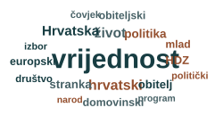

Vrijednosti su zajednički naziv; život i obitelj približavaju područja rasprave.

| Riječ | Broj tekstova | Udio u skupini |

|---|---:|---:|

| vrijednost | 300 | 89,8% |

| hrvatski | 84 | 25,1% |

| život | 81 | 24,3% |

| Hrvatska | 77 | 23,1% |

| politika | 61 | 18,3% |

| stranka | 59 | 17,7% |

| obitelj | 57 | 17,1% |

| HDZ | 56 | 16,8% |

| domovinski | 51 | 15,3% |

| europski | 51 | 15,3% |

| mlad | 49 | 14,7% |

| obiteljski | 49 | 14,7% |

| društvo | 43 | 12,9% |

| politički | 40 | 12,0% |

| čovjek | 40 | 12,0% |

| izbor | 39 | 11,7% |

| narod | 36 | 10,8% |

| program | 36 | 10,8% |

## Europa i kršćanski korijeni

212 tekstova u skupini.

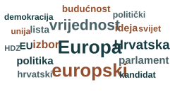

Europa i europske institucije stoje uz izbore, kandidate i budućnost.

| Riječ | Broj tekstova | Udio u skupini |

|---|---:|---:|

| Europa | 147 | 69,3% |

| europski | 141 | 66,5% |

| vrijednost | 93 | 43,9% |

| Hrvatska | 74 | 34,9% |

| izbor | 52 | 24,5% |

| parlament | 47 | 22,2% |

| politika | 47 | 22,2% |

| ideja | 43 | 20,3% |

| lista | 40 | 18,9% |

| EU | 39 | 18,4% |

| budućnost | 38 | 17,9% |

| hrvatski | 36 | 17,0% |

| kandidat | 33 | 15,6% |

| svijet | 33 | 15,6% |

| politički | 32 | 15,1% |

| demokracija | 30 | 14,2% |

| unija | 30 | 14,2% |

| HDZ | 26 | 12,3% |

## Idejna tradicija i javne rasprave

173 tekstova u skupini.

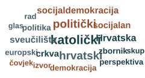

Katolički, sveučilište i zbornik upućuju na prostor stručnih i javnih razgovora.

| Riječ | Broj tekstova | Udio u skupini |

|---|---:|---:|

| katolički | 82 | 47,4% |

| politički | 68 | 39,3% |

| hrvatski | 66 | 38,2% |

| Hrvatska | 47 | 27,2% |

| socijaldemokracija | 43 | 24,9% |

| sveučilište | 43 | 24,9% |

| crkva | 40 | 23,1% |

| socijalan | 40 | 23,1% |

| politika | 35 | 20,2% |

| zbornik | 34 | 19,7% |

| demokracija | 33 | 19,1% |

| europski | 32 | 18,5% |

| perspektiva | 32 | 18,5% |

| izvor | 31 | 17,9% |

| rad | 31 | 17,9% |

| skup | 30 | 17,3% |

| čovjek | 30 | 17,3% |

| glas | 29 | 16,8% |

Brojevi ispod svakog oblaka odnose se samo na tekstove u toj tematskoj skupini. Riječ može biti prisutna u više različitih tema. Osnovni oblici *europski* i *Europa*, primjerice, broje se odvojeno.

# Kako se rasprava širi izvan stranačkog identiteta?

Izborni tekstovi i međunarodne rasprave donose drukčije aktere i okolnosti. Demokršćanstvo se smješta u borbu za politički položaj, ali i u pitanja europske i zapadne suradnje.

## Izbori i konzervativna scena

149 tekstova u skupini.

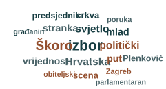

Izborna skupina ističe političku scenu i aktere poput Miroslava Škore.

| Riječ | Broj tekstova | Udio u skupini |

|---|---:|---:|

| izbor | 86 | 57,7% |

| Škoro | 70 | 47,0% |

| Hrvatska | 47 | 31,5% |

| svjetlo | 47 | 31,5% |

| politički | 46 | 30,9% |

| stranka | 41 | 27,5% |

| mlad | 40 | 26,8% |

| put | 38 | 25,5% |

| vrijednost | 38 | 25,5% |

| crkva | 33 | 22,1% |

| scena | 33 | 22,1% |

| Plenković | 31 | 20,8% |

| predsjednik | 30 | 20,1% |

| Zagreb | 24 | 16,1% |

| poruka | 23 | 15,4% |

| građanin | 22 | 14,8% |

| obiteljski | 22 | 14,8% |

| parlamentaran | 22 | 14,8% |

## Njemačka i međunarodni odnosi

72 tekstova u skupini.

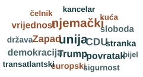

Njemački i CDU označuju stranački okvir; Zapad proširuje međunarodnu dimenziju.

| Riječ | Broj tekstova | Udio u skupini |

|---|---:|---:|

| unija | 44 | 61,1% |

| njemački | 43 | 59,7% |

| CDU | 30 | 41,7% |

| Trump | 27 | 37,5% |

| Zapad | 27 | 37,5% |

| demokracija | 25 | 34,7% |

| povratak | 25 | 34,7% |

| vrijednost | 24 | 33,3% |

| sloboda | 22 | 30,6% |

| stranka | 21 | 29,2% |

| europski | 20 | 27,8% |

| država | 19 | 26,4% |

| kancelar | 18 | 25,0% |

| kuća | 18 | 25,0% |

| sigurnost | 18 | 25,0% |

| transatlantski | 18 | 25,0% |

| čelnik | 18 | 25,0% |

| bijel | 16 | 22,2% |

## Izbori mijenjaju aktere i povode

U izbornoj skupini uz riječ *izbor* ističe se prezime *Škoro*. Rječnik približava demokršćanstvo nadmetanju na hrvatskoj političkoj sceni. Pojava imena govori o prisutnosti aktera u raspravi; sama po sebi ne znači da ga tekst podupire ili da se on u svakom iskazu predstavlja kao demokršćanin.

## Međunarodni okvir ima vlastiti rječnik

U skupini o Njemačkoj i međunarodnim odnosima najviše se ističu *unija*, *njemački* i *CDU*. Riječi poput *Zapad*, *demokracija* i *sloboda* smještaju taj razgovor u širi politički okvir. Zbog toga se sav govor o demokršćanstvu ne može čitati kao rasprava o hrvatskim strankama.

Oblaci prikazuju česte riječi, a ne vremenski slijed događaja. Skupina o izborima ima 149 tekstova, a ona o Njemačkoj i međunarodnim odnosima 72. Veličina riječi uspoređuje se unutar pojedinog oblaka.

# Što se govori kada se spominju vrijednosti?

Pojedinačne riječi otkrivaju područje razgovora. Ustaljeni izrazi pokazuju kako se politička poruka oblikuje. Među odabranim izrazima najraširenije su **demokršćanske vrijednosti**, prisutne u **454 teksta (20,2%)**.

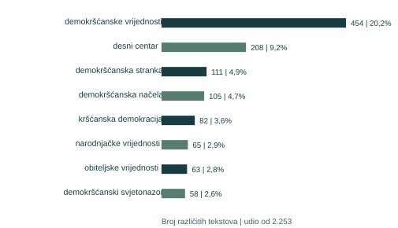

Broji se tekst u kojem se izraz pojavljuje kao niz susjednih riječi, uz objedinjene gramatičke oblike. Broj i postotak odnose se na 2.253 teksta. Isti tekst može sadržavati više izraza; udjeli se ne zbrajaju do 100%.

## Opća oznaka ostavlja prostor različitim značenjima

Izrazi *demokršćanske vrijednosti*, *demokršćanska načela* i *demokršćanski svjetonazor* imenuju pripadnost i sadržaj tradicije, ali ne objašnjavaju uvijek što iz njih slijedi. *Desni centar* određuje politički položaj, dok *narodnjačke* i *obiteljske vrijednosti* dodatno usmjeravaju poruku.

Tri primjera na sljedećim stranicama pokazuju različite upotrebe tog rječnika: poštovanje načela uz odbijanje stranačkog prelaska, obrazlaganje stava o prizivu savjesti i povezivanje europske solidarnosti s razvojem Hrvatske.

# Može li se poštovati ideja bez pripadanja stranci?

OSIJEK | 29. KOLOVOZA 2024. | SAMIR HAJ BARAKAT I IZLAZAK IZ SDP-a

Samir Haj Barakat na sjednici Skupštine Osječko-baranjske županije objavljuje izlazak iz SDP-a i povrat vijećničkog mandata. U razgovoru za Glas Slavonije razloge veže uz svoje nezadovoljstvo stanjem u stranci i provedbom unutarstranačkih izbora. To je njegovo obrazloženje odlaska, a ne utvrđenje o regularnosti tih izbora.

## Poziv u HDZ otvara pitanje političke granice

Novinar ga pita o mogućem prelasku u HDZ jer je Ivan Anušić ranije rekao da bi ga rado vidio u svojoj stranci. Haj Barakat tu mogućnost odbacuje. Ističe da ostaje čovjek lijevih uvjerenja i da odlaskom iz SDP-a ne traži ulazak u drugu stranku.

> „Poštujem demokršćanska načela, ali ne pripadam demokršćanskom spektru”

Samir Haj Barakat, Glas Slavonije; mrežna objava 29. 8. 2024., izdanje tiska 30. 8. 2024.

## Tri odnosa koja se u jednoj izjavi razdvajaju

| Odnos | Što izražava Haj Barakat |
|---|---|
| Prema načelima | Iskazuje poštovanje demokršćanskim načelima. |
| Prema političkom spektru | Vlastita uvjerenja smješta na ljevicu. |
| Prema stranačkom članstvu | Odbija zaključak da izlazak iz SDP-a znači ulazak u HDZ. |

Demokršćanstvo ovdje označuje granicu političke pripadnosti, uz priznanje vrijednosti izvan vlastite stranke. Razlika je važna za čitanje javne rasprave: pohvalna rečenica o načelima ne mora biti poziv na potporu stranci koja se na njih poziva. Ovaj primjer govori o stavu jednog sugovornika.

Izvor: Dario Kuštro, „Samir Haj Barakat napustio SDP: Razočaran sam, u šalabahter-demokraciji ne želim sudjelovati”, Glas Slavonije. [Pročitajte mrežnu objavu](https://www.glas-slavonije.hr/osijek/2024/08/29/vijecnik-haj-barakat-napustio-sdp-osjecam-da-ovdje-nisam-bio-dobrodosao-567954/).

# Što vrijednosti znače kada se odlučuje o pravima?

HRVATSKI SABOR | 20. TRAVNJA 2022. | ANKA MRAK-TARITAŠ I ANDREJ PLENKOVIĆ

U zastupničkom pitanju Anka Mrak-Taritaš iz GLAS-a upozorava na bolnice u kojima, prema njezinu iskazu, zbog liječničkog priziva savjesti nije moguće obaviti pobačaj. U središte stavlja dostupnost zdravstvene usluge. Premijer Andrej Plenković odgovara naglašavanjem liječničkog prava na priziv savjesti te kaže da će provjeriti tvrdnju o nedostupnosti zahvata.

## Demokršćanska oznaka postaje razlog za konkretan stav

Plenković izričito povezuje stranačke vrijednosti s protivljenjem zabrani priziva savjesti. Pozivanje na demokršćanstvo zato u ovom iskazu ima prepoznatljivu posljedicu: određuje što, prema govorniku, njegova stranka neće učiniti.

> „HDZ, kao stranka koja dijeli demokršćanske vrijednosti, neće nikome zabranjivati priziv savjesti”

Andrej Plenković, izjava prenesena u izvještaju Hine, 20. 4. 2022.

## Sugovornici naglašavaju različite probleme

| Sudionik | Središte argumenta |
|---|---|
| Anka Mrak-Taritaš | Mogućnost da žene dobiju zdravstvenu uslugu u bolnici. |
| Andrej Plenković | Zaštita liječničkog priziva savjesti, uz najavu provjere dostupnosti. |

Pitanje dostupnosti i obrana savjesti nisu isti odgovor na problem organizacije zdravstvene skrbi. Razmjena pokazuje kako demokršćansko načelo ulazi u spor o javnim obvezama: treba objasniti i zaštitu osobnog uvjerenja i ono što sustav omogućuje korisnicama. U prenesenoj izjavi nije razrađeno kako će se dostupnost usluge organizirati.

Izvor: Kamenjar/Hina, „Plenković: Milanović primitivnim napadom pokazao ogromnu nervozu”, 20. 4. 2022., odjeljak o prizivu savjesti. Istu razmjenu prenosi [izvještaj Vlade RH o aktualnom prijepodnevu](https://vlada.gov.hr/vijesti/aktualno-prijepodne-zahtjev-za-pomilovanjem-perkovica-i-mustaca-orkestrirana-akcija/35261).

# Kako solidarnost dolazi do pruge i nasipa?

KAMPANJA ZA EUROPSKI PARLAMENT | 7. LIPNJA 2024. | DAVOR IVO STIER

Kandidat HDZ-a za Europski parlament Davor Ivo Stier demokršćansku Europu predstavlja kao prostor solidarnosti koji Hrvatskoj omogućuje približavanje razvijenijim članicama. U izjavi koju prenosi Hina poziva se na Ivana Pavla II. i europsku političku tradiciju, a zatim govori o sasvim konkretnim projektima.

## Od zajedničkog načela do javne infrastrukture

Stier navodi drugi kolosijek pruge Hrvatski Leskovac - Karlovac i sustav obrane od poplava u Karlovačkoj županiji kao primjere projekata financiranih europskim sredstvima. Solidarnost u njegovu argumentu znači suradnju koja otvara razvojne mogućnosti. Željeznica i zaštita od poplava približavaju tu ideju svakodnevnim potrebama stanovnika.

Solidarnost među članicama → Europski fondovi i proračun → Pruge i obrana od poplava

Slijed prikazuje Stierovo obrazloženje: vrijednost, način zajedničkog djelovanja i konkretni projekti.

## Nacionalni interes povezuje se s europskom suradnjom

Stier traži zastupnike koji poznaju europske politike i institucije te zastupaju hrvatske interese. Takvu politiku suprotstavlja pristupima koje naziva sebičnima. Nacionalna pripadnost i europska povezanost u njegovoj su poruci međusobno poduprte: interes Hrvatske ostvaruje se sudjelovanjem u zajedničkim institucijama.

Ovaj primjer pokazuje kako demokršćanski jezik može povezati političko nasljeđe, raspodjelu zajedničkih sredstava i infrastrukturne potrebe. Riječ je o kampanjskom obrazloženju kandidata. Sam medijski iskaz ne pokazuje koliki je gospodarski učinak navedenih projekata.

> Solidarnost dobiva konkretan sadržaj kada se objasni kroz koje se institucije i za koje javne potrebe ostvaruje.

Izvor: Telegram/Hina, „Stier bi EU po mjeri Ivana Pavla II: 'Tako bismo ulovili korak, sagradili pruge i nasipe'”, 7. 6. 2024. Dostupan je i [isti izvještaj Hine na tportalu](https://www.tportal.hr/vijesti/clanak/stier-hdz-za-demokrscansku-europu-kakvu-je-zagovarao-ivan-pavao-ii-20240607).

# Što demokršćanstvo dodaje oznaci desnog centra?

Desni centar govori o političkom položaju. Rasprava o demokršćanskim idejama otvara i odnos pojedinca prema zajednici, tržištu i vlasti. U razgovoru s Matom Mijićem, objavljenom 28. veljače 2021. na portalu Otvoreno, politolog Jakov Žižić upravo kroz te odnose razlikuje demokršćanstvo od drugih političkih tradicija.

## Zajednica, tržište i razine odlučivanja

Žižić demokršćanstvu pripisuje snažan naglasak na solidarnosti sa zajednicom. Prihvaćanje privatne inicijative i tržišta, u njegovu tumačenju, prati uloga države u ublažavanju nepovoljnih posljedica tržišnog djelovanja radi općeg dobra. Time razliku prema liberalnom konzervativizmu smješta u sadržaj gospodarske i socijalne politike.

Supsidijarnost povezuje s raspodjelom ovlasti između lokalne, regionalne, državne i europske razine. Nasuprot tome, nacionalnim konzervativcima pripisuje težnju koncentriranju moći u nacionalnoj državi. To je njegovo tumačenje razlike među tradicijama, koje objašnjava zašto se njihova bliskost na političkom spektru ne mora pretvoriti u isti odnos prema europskim institucijama.

| Riječ | Tekstovi s tom riječju | Udio od 2.253 |
|---|---:|---:|
| vrijednost | 1.123 | 49,8% |
| solidarnost | 103 | 4,6% |
| savjest | 29 | 1,3% |
| supsidijarnost | 27 | 1,2% |

Broji se osnovni oblik riječi u rečenicama o temi. Ovi brojevi opisuju cijelu zbirku, a ne Žižićev razgovor. Tekst se može pojaviti u više redaka.

## Rjeđa riječ može otvoriti važno javno pitanje

Opći govor o vrijednostima šire je rasprostranjen od izričitog imenovanja solidarnosti, savjesti ili supsidijarnosti. Konkretni primjeri pokazuju što se može razviti iza takvih riječi: političko razgraničenje, stav o zdravstvenoj skrbi, europski razvoj ili podjela vlasti. Njihova je važnost u objašnjenju veze između načela i djelovanja, a ne samo u broju spominjanja.

> Značenje demokršćanstva u javnosti postaje jasnije kada se uz ime tradicije navedu problem, obrazloženje i očekivana odluka.

Izvor razgovora: Otvoreno, „Žižić: Približavanjem demokršćana ljevici otvorio bi se veliki prostor za nacionalne konzervativce”, 28. 2. 2021.; sugovornik Jakov Žižić, razgovarao Mate Mijić. Podaci o riječima: medijski materijal projekta DigiKat.
