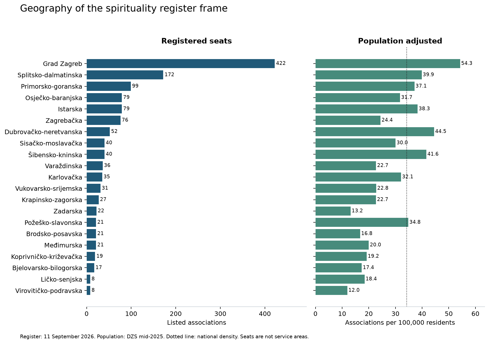
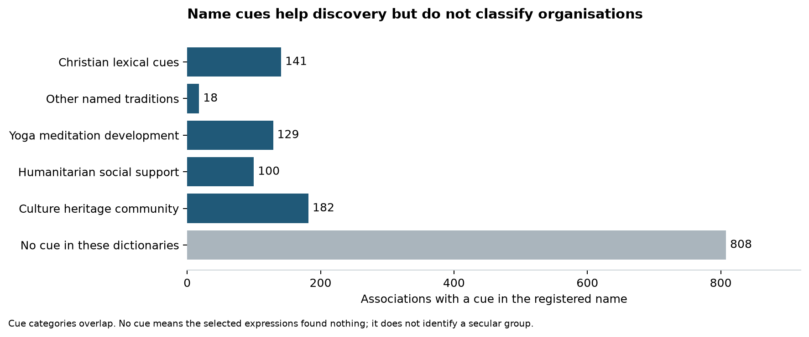
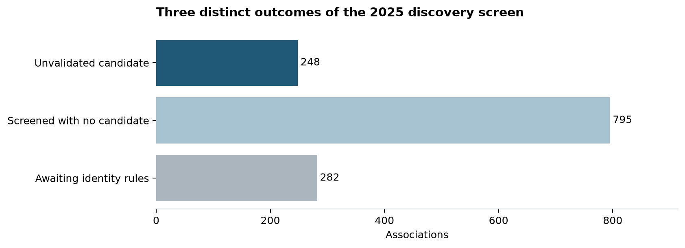
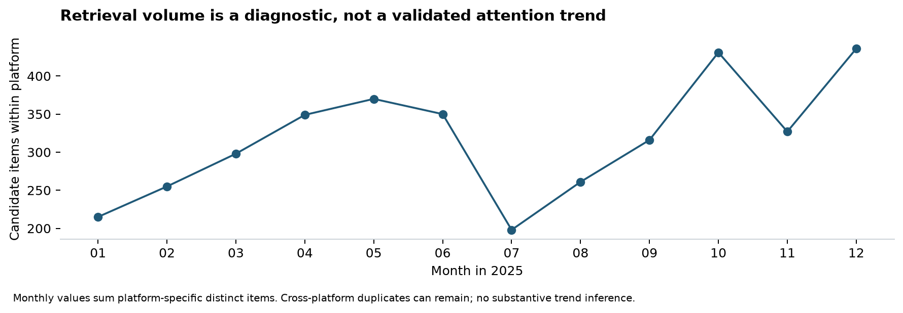
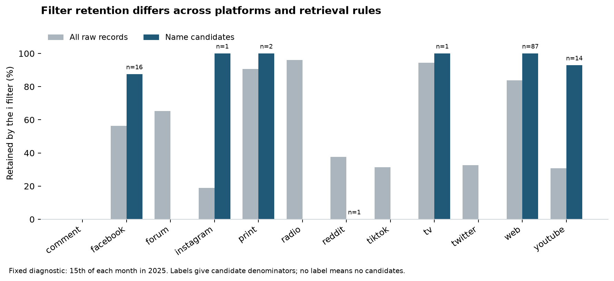

# Croatia spirituality associations and public visibility

Exploratory report dated 19 September 2026

## What this first exploration establishes

The supplied register is a reliable starting frame for an organisational atlas: all 1,325 entries reconcile independently to the PDF and its 21 county totals, with no discrepancies in IDs, normalized names, counties or page references. The frame is substantively broad. Its administrative spirituality label includes associations whose own descriptions emphasize religious formation, Buddhist practice, yoga, social care, volunteering, publishing and cultural heritage. Activities and declared orientation need separate coding.

The national geography is already measurable. Grad Zagreb contains 422 associations, or 31.8% of the list, against 20.1% of the mid-2025 population. Its 54.3 registered seats per 100,000 residents also gives it the highest population-adjusted density. Headquarters and actual service areas still need distinction.

The first full-year media screen found 3,806 unique candidate items associated with 248 registered organisations. Those are discovery results, not validated visibility. Of the 1,043 organisations with initial rules, 795 had no candidate; 282 other names require stronger identity rules and have not been searched. All 1,325 rows remain in the directory.

## Data collected and provenance

| Resource | Observed scope | Role |
|---|---:|---|
| Supplied PDF and JSON | 1,325 IDs and 74 PDF pages | Closed administrative frame |
| Official population estimates | 21 counties and 3,874,993 residents | Geographical denominator |
| Saved official organisation pages | 11 pages attempted; 9 in-frame profile groups | Documentary enrichment |
| General merged media snapshot | 41,748,837 records | Read-only source population |
| Calendar 2025 | 8,514,361 records on 365 dates | Candidate screen |
| Unfiltered diagnostic exports | 510,471 records on 12 fixed dates | Filter sensitivity |

The PDF report date is 11 September 2026. The earlier brief called this a September snapshot correctly, but its media database totals have since changed. The measured local snapshot covers 2021-01-01 through 2026-09-10; the report pins this run instead of repeating earlier database totals. It does not search only the Catholic DigiKat corpus.

Raw supplied files and website HTML are retained privately with SHA-256 hashes. The large source database is identified by file size, modification time, schema, measured counts and date bounds; it was opened read-only and its file fingerprint stayed unchanged. All figures and numeric claims are generated from the study tables.

## Registered geography

| County | Associations | Share of frame | Per 100,000 residents |
|---|---:|---:|---:|
| Grad Zagreb | 422 | 31.8% | 54.3 |
| Splitsko-dalmatinska | 172 | 13.0% | 39.9 |
| Primorsko-goranska | 99 | 7.5% | 37.1 |
| Istarska | 79 | 6.0% | 38.3 |
| Osječko-baranjska | 79 | 6.0% | 31.7 |
| Zagrebačka | 76 | 5.7% | 24.4 |
| Dubrovačko-neretvanska | 52 | 3.9% | 44.5 |
| Sisačko-moslavačka | 40 | 3.0% | 30.0 |
| Šibensko-kninska | 40 | 3.0% | 41.6 |
| Varaždinska | 36 | 2.7% | 22.7 |
| Karlovačka | 35 | 2.6% | 32.1 |
| Vukovarsko-srijemska | 31 | 2.3% | 22.8 |
| Krapinsko-zagorska | 27 | 2.0% | 22.7 |
| Zadarska | 22 | 1.7% | 13.2 |
| Brodsko-posavska | 21 | 1.6% | 16.8 |
| Međimurska | 21 | 1.6% | 20.0 |
| Požeško-slavonska | 21 | 1.6% | 34.8 |
| Koprivničko-križevačka | 19 | 1.4% | 19.2 |
| Bjelovarsko-bilogorska | 17 | 1.3% | 17.4 |
| Ličko-senjska | 8 | 0.6% | 18.4 |
| Virovitičko-podravska | 8 | 0.6% | 12.0 |

Population estimates come from [DZS STAN-2026-3-1, table 1](https://podaci.dzs.hr/2026/hr/121477), published 4 September 2026. They refer to mid-2025, whereas organisations are listed in September 2026. The national density is 34.2 per 100,000. Rates describe registered seats, not membership, local participation, current activity or service reach. Population adjustment leaves Zagreb first but changes the ordering of several other counties.

## Register completeness and organisational diversity

Only 60 entries (4.5%) have a website field, and 490 (37.0%) have an email field. These are field-completeness measures. Website research recovered channels absent from the list, so an empty cell cannot establish online absence. No personal email addresses were copied into the derived register CSV. Registered locality candidates could be extracted by the final-comma rule for 1,324 entries; these are not validated geocodes.

The selected name dictionaries leave 808 associations without any cue and give 49 more than one cue. They deliberately miss many implicit and local identities. The following priority strata are only a way to organize the feasibility sample; they are not estimates of religious or organisational family prevalence.

| Sampling stratum | Listed | Screened | With candidates |
|---|---:|---:|---:|
| Christian lexical cues | 141 | 138 | 38 |
| Culture heritage community | 147 | 144 | 47 |
| Humanitarian social support | 88 | 87 | 23 |
| No cue in these dictionaries | 808 | 543 | 128 |
| Other named traditions | 18 | 17 | 1 |
| Yoga meditation development | 123 | 114 | 11 |

The 60-case pilot contains ten organisations per stratum and covers all 21 counties. Selected public-facing cases are purposive; the remaining slots expand county diversity with a fixed hash tie-break. The sample is not representative, and results must not be extrapolated as national percentages.

The [official-source profile notes](WEB_EVIDENCE.md) cover nine contrasting groups and 17 register entries. [Breza](https://breza.hr/o-nama/) describes social support, youth and community work without establishing a religious identity. [SKAC Palma](https://www.skac.hr/upoznaj-skac/) and [SKAC Split](https://skac.st/o-nama/) connect Catholic or Christian formation to education and volunteering. [Korablja](https://korablja-arka.hr/tko-smo/) identifies its Arka community and international network. [Padmasana](https://padmasana.hr/en/o-nama/) describes Buddhist practice and a centre outside its registered-seat city. [Zdenac](https://zdenac.org/o-nama) and the [yoga network](https://www.yoga-in-daily-life.hr/centri) show why legal entities and shared public names must be separated. [Kršćanski akademski krug](https://www.krakr.hr/index.php/o-nama/sto-je-krscanski-akademski-krug.html) and the [Hvar branch of Matica hrvatska](https://www.matica.hr/ogranci/ogranak-matice-hrvatske-u-hvaru/) illustrate intellectual and cultural activities. These are documentary proposals awaiting human review; the baseline register's unknown values are preserved.

Two Zdenac IDs print the same domain. Their legal relationship is unresolved. The Samobor Matica branch was discovered online but is absent from the supplied frame; it was not added to the population. These are useful identity checks, not reasons to silently merge or expand the register.

## What the 2025 media screen found

The 8,514,361-record search yielded 3,813 raw candidate rows, 3,806 deduplicated candidate items and 3,961 organisation-item pairs. One item may mention several organisations, and one pair may match several routes. The discovery rules use complete multiword registered names and a small set of curated aliases. 282 short or generic names are explicitly held for additional identity work. Search text is title plus body; no Catholic keyword prefilter was imposed.

In the 60-case pilot, 18 organisations had a candidate, 37 were screened without a candidate, and 5 await rules. Apparent misses have their own follow-up sheet, and the candidate queue contains 453 review records. Human coding fields remain blank. The small curated alias set adds 271 candidate items and 3 association names beyond full-name retrieval, demonstrating the importance of alias work without establishing recall.

The 15 purposively selected AI development readings identified substantive organisational mentions, names embedded in related-article boilerplate, generic sayings, tag lists and a false name formed by a section label next to a headline. These readings are saved separately from human coding and support no precision estimate. A full-name hit therefore does not by itself establish article relevance. Material from institutional pages and own websites also means an external domain cannot automatically count as independent reporting. Source-level affiliation and social-account verification remain pending.

Candidate attention is uneven: the ten highest candidate counts account for 31.0% of organisation-item pairs. This is a retrieval diagnostic, not a supported result about public attention concentration. Name length, aliases, boilerplate, current-frame selection and unknown historical existence can all change that distribution. No substantive ranking or inferential test is reported.

## What the standalone word filter changes

The deterministic audit reread unfiltered exports for the fifteenth of every month in 2025. Of 510,471 raw records, 275,967 (54.1%) passed the documented filter. Of 122 candidate records found with the same title/body rules, 118 (96.7%) passed; 4 were removed.

Of 87 web candidates in the diagnostic, 87 passed. Candidate losses occurred on facebook, reddit, youtube. Several platform denominators are tiny, so the chart is a diagnostic rather than a stable platform comparison. Fixed dates are not a random sample; this result cannot estimate an annual correction factor, recover dissolved organisations, measure short-alias recall, or establish the visibility of unscreened organisations. Revised raw exports may also differ from the imported merged snapshot. A broader unfiltered extraction remains preferable when testing social-platform visibility.

## Readiness for the paper

The administrative frame, geography, source provenance, reproducible discovery pipeline and feasibility sample are ready for the next stage. The evidence supports a study of a heterogeneous administrative category and the measurement of its visibility. It does not yet support a national prevalence of organisational orientations or the share of associations receiving independent news coverage.

The next work should verify the pilot's legal identity and existence in 2025; expand inflected names and contextual aliases; investigate apparent zeros; verify owned domains and social accounts; and have two people independently code held-out candidate passages. Distinguish substantial coverage from incidental mentions and boilerplate. Resolve branch/umbrella relationships before grouping records. Once these checks pass, compute validated observation, monthly persistence, independent outlet breadth and concentration, using consistent platforms and denominators. Keep organisations with zero validated observations in the atlas, with uncertainty explicit.

## Reproduction and data availability

See [README](README.md), [protocol](PROTOCOL.md), [codebook](CODEBOOK.md) and [official-source notes](WEB_EVIDENCE.md). The scripts run from the repository root. The searchable local directory, source register, candidates, official-page evidence and blank review sheets are in gitignored `output/private/`. Aggregate tables and figures contain no media rows. Restricted vendor text and personal contact fields are not redistributed. These are exploratory research outputs, not an approved public data release.

Codex assisted with extraction, code, analysis and drafting. Documentary proposals and development readings are AI-assisted; they are not independent human validation. No organisations were contacted. Core sources are the supplied register PDF and JSON; the read-only DetermDB snapshot and its local data dictionaries; the twelve unfiltered exports; DZS table 1; and the linked official organisation pages. The machine-readable provenance files identify the exact local inputs and output hashes.
