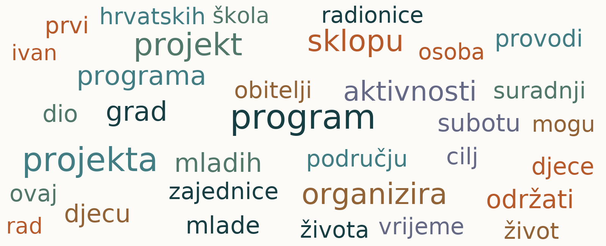
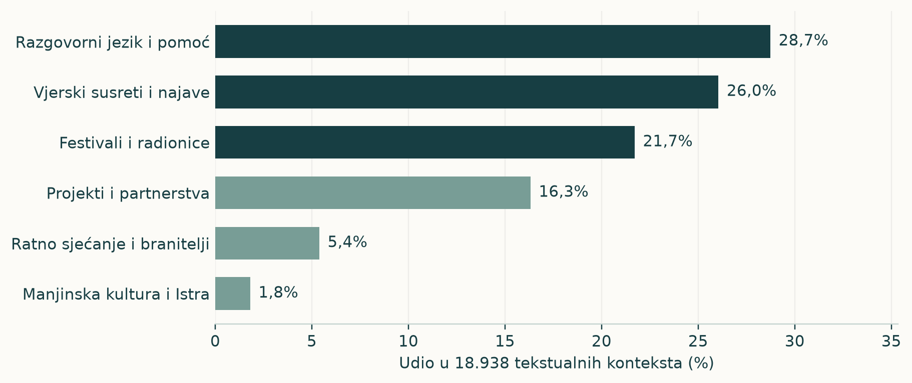
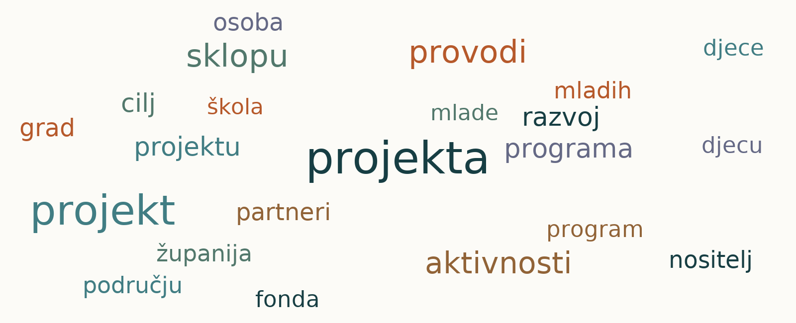
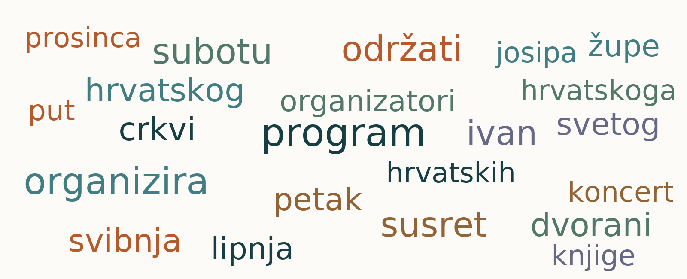
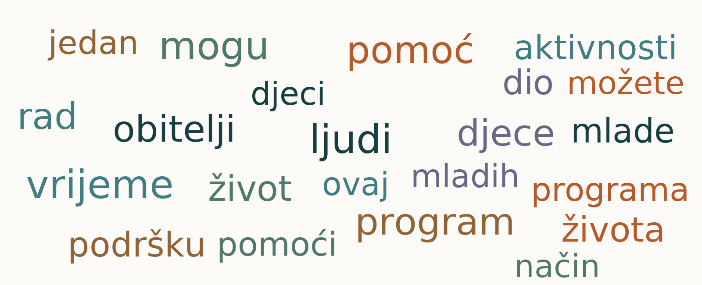
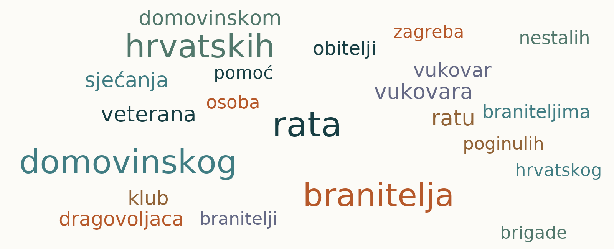
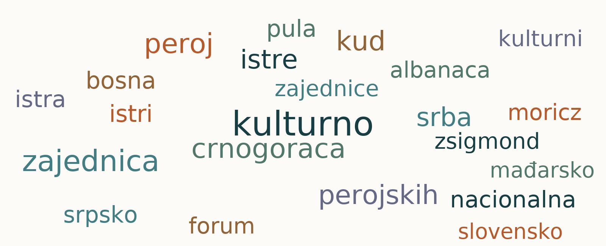
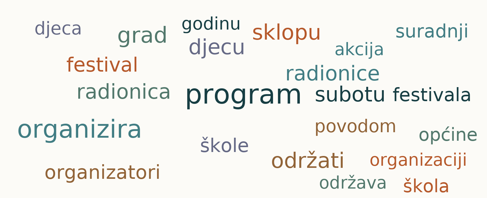
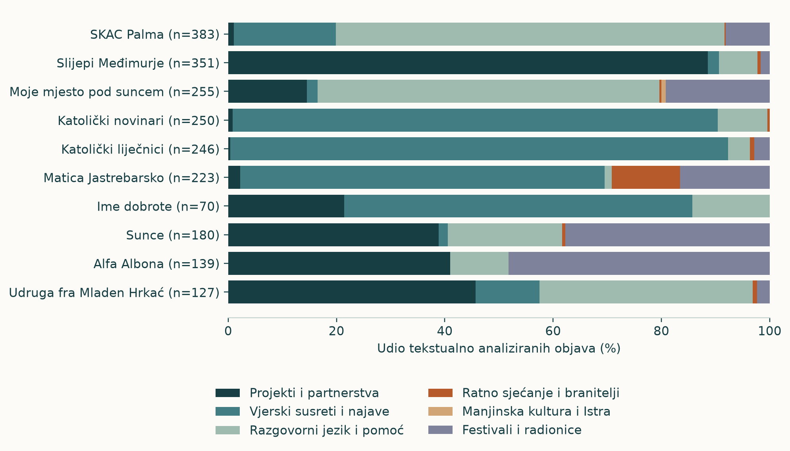

<!-- PAGE: Ključni nalazi | Riječi otkrivaju kakvo javno mjesto organizacija zauzima -->

Udruge se u javnom prostoru predstavljaju kroz ono što rade: organiziraju programe, provode projekte, okupljaju sudionike i govore o potrebama ljudi. Jezični pregled povezuje **18.938 tekstualnih konteksta** s profilima vodećih organizacijskih naziva i medijima na kojima se pojavljuju.

## Organizacije imaju različite prepoznatljive rječnike

Uz **SKAC Palmu** ističu se mladi, prijave i duhovne vježbe. Uz **Udrugu slijepih Međimurske županije** pojavljuju se aktivnosti, provedba i programi. Uz **Moje mjesto pod suncem** ponavljaju se siromaštvo, djeca i socijalno uključivanje. Katolička strukovna društva povezuju komunikacije i medicinu s vjerskim susretima.

## Teme se raspoređuju oko aktivnosti i publika

Šest tematskih skupina obuhvaća projekte i partnerstva, vjerske susrete i najave, razgovorni jezik i pomoć, ratno sjećanje, manjinsku kulturu te festivale i radionice. Organizacijski profili pokazuju koji je dio toga rječnika najizraženiji uz pojedini naziv.

## Medij daje sadržaju prostor i oblik

SKAC Palma povezuje svoju stranicu s katoličkim portalima. Međimurska udruga slijepih pojavljuje se kroz regionalne vijesti i programe podrške, a Moje mjesto pod suncem kroz riječke i druge medije. Isti pregled riječi zato ujedno govori o temama, javnim ulogama i krugovima objavljivanja.

~ Polazište je popis od 1.325 udruga i 23.436 objava uz njihove nazive, od 1. siječnja 2021. do 10. rujna 2026. Organizacijski profili prate deset vodećih naziva prema mrežnim objavama s imenom u naslovu ili uvodu.

<!-- PAGE: Ukupni rječnik | Projekti, programi i pomoć povezuju različite organizacije -->

Oblak prikazuje česte riječi u **18.938 tekstualnih konteksta**. Veličina riječi prati broj objava u čijem se kontekstu pojavljuje. U središtu rječnika nalaze se aktivnosti, programi i odnos prema ljudima.

| Oblik riječi | Broj konteksta od 18.938 |
|---|---:|
| projekt | 1.973 |
| program | 2.333 |
| pomoć | 914 |

Projekt smješta aktivnost u organizirani okvir, program povezuje sadržaj i sudionike, a pomoć usmjerava pozornost na potrebe ljudi. Njihova istodobna zastupljenost pokazuje koliko je javni govor o udrugama vezan uz konkretno djelovanje.

~ Svaki se oblik riječi broji jednom po kontekstu objave. Primjerice, *projekt* i *projekta* zasebni su oblici. Izvor: word_document_frequency.csv. Boja i položaj riječi služe grafičkom rasporedu.

<!-- PAGE: Tematska karta | Šest skupina opisuje glavne jezične tokove -->

Tematska karta povezuje kontekste sa sličnim rječnikom. Svaki se kontekst raspoređuje u skupinu koja je u njemu najizraženija. Nazivi skupina sažimaju sadržaj njihovih čestih riječi i primjera.

Najveća skupina, **razgovorni jezik i pomoć**, okuplja **5.442 konteksta (28,7%)**. Povezuje osobno obraćanje, iskustvo i govor o ljudima. **Vjerski susreti i najave** imaju **4.933 (26,0%)**, a **festivali i radionice 4.111 (21,7%)**.

**Projekti i partnerstva** donose jezik provedbe i organizacije. Preostale dvije skupine izdvajaju javno sjećanje i regionalnu kulturnu pripadnost. Karta tako spaja institucionalne, iskustvene i kulturne oblike govora.

~ Izvor: topics.csv. Udjeli se odnose na tekstualne kontekste; sljedeće stranice prikazuju rječnik svake skupine.

<!-- PAGE: Rječnici / projekti i susreti | Projekt povezuje partnere, a susret okuplja sudionike -->

## Projekti i partnerstva: 3.090 konteksta

Riječi o provedbi, aktivnostima i partnerima predstavljaju organizaciju kroz raspored zadataka. U središtu su program, nositelj i suradnja. Takav je jezik osobito izražen uz Udrugu slijepih Međimurske županije.

## Vjerski susreti i najave: 4.933 konteksta

Rječnik okupljanja povezuje program, mjesto i vrijeme susreta. Katolička strukovna društva u tom prostoru predstavljaju događaje, stručnu zajednicu i vjerski kalendar.

~ Izvor obaju oblaka: word_document_frequency.csv. Veličine riječi uspoređuju se unutar pojedinog oblaka.

<!-- PAGE: Rječnici / iskustvo i sjećanje | Osobni govor i javno obilježavanje imaju različite naglaske -->

## Razgovorni jezik i pomoć: 5.442 konteksta

Riječi o ljudima, životu i pomoći približavaju iskustvo. Ovaj široki rječnik povezuje poziv na sudjelovanje, osobnu priču i opis potreba. Snažno je zastupljen uz SKAC Palmu i Moje mjesto pod suncem.

## Ratno sjećanje i branitelji: 1.020 konteksta

Rat, branitelji i sjećanje smještaju organizacije u prostor obilježavanja i javne memorije. Aktivnosti dobivaju značenje kroz povijesni događaj, zajednicu i mjesto okupljanja.

~ Izvor: word_document_frequency.csv. Svaka riječ broji se jednom po tekstualnom kontekstu unutar skupine.

<!-- PAGE: Rječnici / kultura i programi | Lokalni prostor dobiva sadržaj kroz događaje -->

## Manjinska kultura i Istra: 342 konteksta

Rječnik povezuje kulturne zajednice, regionalnu pripadnost i organizacije. U njemu se prepoznaje javno predstavljanje zajednice kroz kulturne programe i lokalno djelovanje.

## Festivali i radionice: 4.111 konteksta

Programi za djecu, radionice i festivali naglašavaju sudjelovanje. Alfa Albona u toj skupini povezuje mlade, Labin i mogućnosti uključivanja u aktivnosti.

~ Izvor: word_document_frequency.csv. Oblaci prikazuju česte oblike riječi u svakoj skupini.

<!-- PAGE: Organizacijski profili | Tematski se naglasci snažno razlikuju među vodećim nazivima -->

Usporedba deset vodećih naziva pokazuje nekoliko jasnih obrazaca. Projekti dominiraju uz međimursku udrugu slijepih, susreti i najave uz katolička strukovna društva, a razgovorni jezik uz SKAC Palmu i Moje mjesto pod suncem.

Uz **Sunce** su projekti i partnerstva zastupljeni s **38,9%**, a festivali i radionice s **37,8%**. Uz **Alfa Albonu** te skupine čine **41,0%** i **48,2%**. U oba profila javna se aktivnost opisuje projektnim jezikom i pozivima na sudjelovanje.

~ Organizacijska usporedba broji jednu mrežnu adresu po nazivu, uz ime u naslovu ili prvih 800 znakova teksta. Tematski prikaz koristi tekstualno analizirane objave iz te usporedbe.

<!-- PAGE: Usporedba riječi | Deset naziva, deset prepoznatljivih rječnika -->

Odabrane česte riječi daju sadržaj tematskim profilima. Broj u zagradi pokazuje u koliko se analiziranih mrežnih objava uz pojedini naziv riječ pojavljuje.

| Naziv | Odabrane riječi (broj objava) |
| --- | --- |
| SKAC Palma | mlade (109), prijave (75), duhovne (71), vježbe (64) |
| Udruga slijepih Međimurske županije | slijepih (209), aktivnosti (109), provodi (106), projekta (91) |
| Moje mjesto pod suncem | siromaštva (119), program (102), djece (84), dijaloga (79) |
| Hrvatsko društvo katoličkih novinara | komunikacija (57), medija (35), nagrade (44), priznanja (43) |
| Hrvatsko katoličko liječničko društvo | podružnica (44), života (37), medicine (30), skup (28) |
| Matica hrvatska u Jastrebarskom | program (99), poetsko (50), glazbeni (49), kazalište (35) |
| Ime dobrote | progledaj (27), srcem (27), misa (27), radionice (13) |
| Sunce | otpada (41), mora (34), okoliša (32), organizira (38) |
| Alfa Albona | projekta (61), mladih (40), radionice (27), aktivnosti (31) |
| Humanitarna udruga fra Mladen Hrkać | projekta (36), provodi (35), volonterka (23), bolničkom (24) |

Rječnici jasno razdvajaju publike i aktivnosti: mladi i prijave, slijepe osobe i programi, djeca i siromaštvo, komunikacije i medicina, okoliš i radionice. Javna uloga postaje vidljiva kroz vezu organizacije s konkretnim sadržajem.

~ Izvor: organisation_words.csv. Svaki oblik broji se jednom po kontekstu; nazivi i tehničke oznake stranica izostavljeni su iz izbora riječi za tablicu.

<!-- PAGE: Jezični portret / SKAC Palma | Poziv i osobno iskustvo oblikuju jezik sudjelovanja -->

**390 mrežnih objava na 26 domena** daje SKAC-u Palma prvo mjesto u organizacijskoj usporedbi. Najzastupljenije su **skac.hr (137); hkm.hr (55); laudato.hr (51)**. Jezični profil povezuje buduće sudionike, program i poziv.

| Odabrani oblik | Broj objava od 383 |
|---|---:|
| mlade | 109 |
| prijave | 75 |
| duhovne | 71 |
| vježbe | 64 |
| program | 62 |

## Informacija i iskustvo nadopunjuju se

Poziv na vikend pokore iz siječnja 2021. donosi termine, dobnu skupinu i način prijave. Uz praktične informacije pojavljuje se iskustvo sudionice. Organizacijski glas objašnjava kako sudjelovati, a osobni glas približava duhovni smisao programa.

U kasnijim najavama pojavljuju se ljetni kampovi i korizmeni programi. Poveznica među objavama jest sudjelovanje: kome je program namijenjen, što se tijekom njega događa i kakvo iskustvo nudi.

Razgovorni jezik i pomoć čine **71,8%** analiziranih konteksta. Taj udio odgovara profilu u kojem se programske obavijesti često povezuju s izravnim obraćanjem i osobnim iskustvom.

~ Izvori: organisation_words.csv, organisation_topics.csv i organisation_outlets.csv; arhivirani tekstovi HKM-a iz 2021. i 2024.

<!-- PAGE: Jezični portret / podrška | Provedba i aktivnosti daju uslugama konkretan oblik -->

**Udruga slijepih Međimurske županije** ima **352 mrežne objave**. Najzastupljenije domene su **medjimurjepress.net (56); muralist.hr (52); radio1.hr (34)**. Regionalna prisutnost povezuje se s rječnikom redovitih programa i podrške.

| Odabrani oblik | Broj objava od 351 |
|---|---:|
| slijepih | 209 |
| aktivnosti | 109 |
| provodi | 106 |
| projekta | 91 |
| programa | 82 |

## Jezik projekta usmjerava pozornost na svakodnevni život

Projekti i partnerstva čine **88,6%** analiziranih konteksta. Riječ *provodi* organizaciju prikazuje kao nositelja aktivnosti, a *programa* i *projekta* povezuju pojedinu radionicu s duljim razdobljem rada.

U člancima se opisuju volontiranje, pomoć u nastavi, osnaživanje slijepih žena i podrška samostalnosti mladih članova. Aktivnosti su predstavljene kroz korisnike i zadatke. Socijalna podrška dobiva konkretan sadržaj u školi, radionici i svakodnevnom odnosu prema drugima.

Medijski profil tako spaja lokalni prostor, provedbu programa i iskustvo korisnika. Čitatelj udrugu susreće kao organizatora kontinuirane podrške.

~ Izvori: organizacijske tablice; arhivirani tekstovi Regionalnog, Muralista i Međimurskog.

<!-- PAGE: Jezični portret / uključivanje | Siromaštvo i djeca u središtu su riječkog programa -->

Naziv **Moje mjesto pod suncem** pojavljuje se u **256 mrežnih objava** na **69 domena**. Vode **novilist.hr (36); torpedo.media (28); teklic.hr (17)**. Uz organizacijski naziv prisutan je istoimeni program socijalnog uključivanja.

| Odabrani oblik | Broj objava od 255 |
|---|---:|
| siromaštva | 119 |
| program | 102 |
| djece | 84 |
| dijaloga | 79 |

## Problem, korisnici i zajednica povezani su u istoj poruci

Riječ *siromaštva* određuje društveni problem, *djece* skupinu u središtu programa, a *program* organizirani odgovor. U objavama iz 2021. donatorska kampanja povezuje prikupljanje sredstava s uređenjem prostora za djecu i obitelji. Program se predstavlja kroz mogućnost sudjelovanja u zajedničkom životu.

Objave iz travnja 2024. povezuju program s manifestacijom *Homo si teć* i s pričama o dječjim odnosima. Lokalni događaj i osobno iskustvo približavaju istu temu iz različitih smjerova: javno prikupljanje podrške i svakodnevno pripadanje.

Razgovorni jezik i pomoć obuhvaćaju **63,1%** analiziranih konteksta. Rječnik i konkretni primjeri zajedno pokazuju naglasak na socijalnoj uključenosti djece.

~ Izvori: organizacijske tablice; arhivirani tekstovi MojeRijeke, Teklića, Sportcoma i Torpeda.

<!-- PAGE: Jezični portreti / struka | Komunikacije i medicina daju susretima stručni sadržaj -->

Novinarsko i liječničko društvo dijele snažnu zastupljenost vjerskih susreta i najava, ali se njihove stručne teme jasno razlikuju. **Hrvatsko društvo katoličkih novinara** ima **251**, a **Hrvatsko katoličko liječničko društvo 246** mrežnih objava.

| Organizacija | Odabrane riječi i broj objava |
|---|---|
| Katolički novinari | komunikacija (57), medija (35), nagrade (44), priznanja (43) |
| Katolički liječnici | podružnica (44), života (37), medicine (30), skup (28) |

## Komunikacije povezuju struku, medije i priznanja

Uz novinarsko društvo ponavljaju se društvene komunikacije, mediji, nagrade i priznanja. Takav rječnik predstavlja profesionalnu zajednicu kroz komunikacijske teme i vrednovanje rada njezinih članova. Najzastupljenije su domene **hdkn.hr (146); ika.hkm.hr (57); laudato.hr (7)**.

## Medicina se povezuje s podružnicama i pitanjima života

Uz liječničko društvo riječ *podružnica* pokazuje organizacijsku razgranatost, a *medicine* i *života* stručni i vrijednosni sadržaj. Objave uključuju tribinu povodom Dana života, stručne susrete i blagdan sv. Luke. Vode **hkld.hr (101); ika.hkm.hr (46); biskupija-varazdinska.hr (7)**.

Vjerski susreti i najave čine **89,6%** analiziranih konteksta novinarskog i **91,9%** liječničkog društva. Zajednički oblik okupljanja dobiva različit stručni sadržaj.

~ Osnovice tekstualne analize: novinarsko društvo 250, liječničko 246. Izvori: organisation_words.csv, organisation_topics.csv i organisation_outlets.csv.

<!-- PAGE: Jezični portreti / okoliš i mladi | Sunce i Alfa Albona povezuju projekte sa sudjelovanjem -->

**Sunce** ima **180 mrežnih objava** na 63 domene, a **Alfa Albona 139** na 13 domena. Oba profila povezuju organizaciju projekta s aktivnostima namijenjenima javnosti.

| Organizacija | Odabrane riječi i broj objava |
|---|---|
| Sunce | otpada (41), mora (34), okoliša (32), organizira (38) |
| Alfa Albona | projekta (61), mladih (40), radionice (27), aktivnosti (31) |

## Sunce usmjerava pozornost na okoliš

Riječi o otpadu, moru i okolišu povezuju se s očuvanjem Jadrana, akcijama čišćenja i organizacijom aktivnosti. Projekti i partnerstva čine **38,9%**, a festivali i radionice **37,8%** analiziranih konteksta. Najzastupljenije su domene **dalmatinskiportal.hr (22); dalmacijadanas.hr (14); morski.hr (13)**.

## Alfa Albona govori jezikom mogućnosti za mlade

Projekti, mladi i radionice povezuju se s Labinom i programima uključivanja. Objave o kampanji *Time to Move* predstavljaju informacije i aktivnosti namijenjene mladima. Festivali i radionice čine **48,2%**, a projekti i partnerstva **41,0%**. Vode **alfa-albona.hr (36); 5portal.hr (30); radiolabin.hr (20)**.

Razlika je u predmetu djelovanja: okoliš i zajednički prostor kod Sunca, mladi i sudjelovanje kod Alfa Albone. Zajednički je jezik organiziranih aktivnosti.

~ Osnovice: Sunce 180, Alfa Albona 139 tekstualnih konteksta. Izvori: organizacijske tablice.

<!-- PAGE: Jezični portreti / kultura i pomoć | Program, umjetnost i volontiranje povezuju publike -->

Preostala tri vodeća naziva dodatno proširuju sadržaj javne prisutnosti. Kulturni program, medijski povezano djelovanje i humanitarni rad imaju različite prepoznatljive riječi.

## Matica hrvatska u Jastrebarskom

U **223** analizirana konteksta riječ **program** pojavljuje se u **99**, **poetsko** u **50**, a **glazbeni** u **49**. Uz **227 mrežnih objava** profil povezuje kulturno stvaralaštvo, lokalnu baštinu i vjerski kalendar. Vode **matica.hr (62); jaskadanas.hr (35); jastrebarsko.hr (22)**.

## Ime dobrote

Među **70** analiziranih konteksta **progledaj** i **srcem** pojavljuju se svaki u **27**, a **radionice** u **13**. Uz program *Progledaj srcem online* prisutne su i riječi *misa*, *uživo* i *klanjanje*. Od **205 mrežnih objava**, **182** dolazi s Laudata. Profil spaja umjetničke programe i vjerski medijski sadržaj.

## Humanitarna udruga fra Mladen Hrkać

U **127** analiziranih konteksta pojavljuju se oblici **projekta (36)**, **provodi (35)**, **volonterka (23)** i **bolničkom (24)**. Rječnik ističe projekte, volonterski rad i bolničko okruženje. Udruga je prisutna na **77 domena**, uz vodeće **obican.info (9); hkm.hr (5); ika.hkm.hr (5)**.

~ Izvori: organisation_ranking.csv, organisation_words.csv i organisation_outlets.csv. Brojevi označuju objave u kojima se pojavljuje odabrani oblik riječi.

<!-- PAGE: Glasovi i izvori | Riječ postaje javna poruka kroz radnju i govornika -->

Jezični profili pokazuju što se uz organizacije ponavlja. Konkretan tekst povezuje te riječi s radnjama i govornicima. U javnom prostoru pomoć postaje raspodjela donacija, program postaje poziv na sudjelovanje, a intelektualni rad postaje publikacija dostupna čitatelju.

| Primjer | Sadržaj javne poruke |
|---|---|
| SKAC Split na Splitv-portalu | Volonteri opisuju raspodjelu donacija i pomoć obiteljima nakon potresa. |
| SKAC Palma na HKM-u | Organizacijska najava i iskustvo sudionice približavaju duhovni program. |
| Korablja u opisu emisije Argumenti | Povezanost gostiju s udrugom uvodi temu invaliditeta i uključivanja. |
| Kršćanski akademski krug uz časopis Nova prisutnost | Publikacija predstavlja intelektualni, društveni i duhovni prostor. |

U prvom primjeru organizacija govori o učinjenom. U drugom poziva publiku na sudjelovanje. U trećem se pojavljuje kroz sugovornike, a u četvrtom kroz publikaciju. Broj objava, medijski kanal i sadržaj poruke zajedno objašnjavaju njezinu javnu ulogu.

## Prateći podaci

Popis: 1.325 udruga iz područja duhovnosti. Medijski pregled: 23.436 objava uz njihove nazive, od 1. siječnja 2021. do 10. rujna 2026. Rječnici i šest tema: 18.938 konteksta. Organizacijski profili: vodeći nazivi među 7.219 mrežnih objava s istaknutim imenom.

~ Izvori: word_document_frequency.csv, topics.csv, organisation_ranking.csv, organisation_outlets.csv, organisation_words.csv i organisation_topics.csv; arhivirani slučajevi C2-C5. Postupak izračuna nalazi se u reader-reports/README.md. Priprema uz pomoć umjetne inteligencije. Izdanje: 22. rujna 2026.
