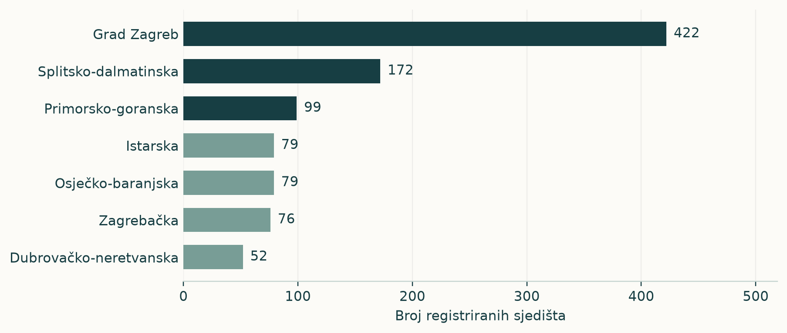
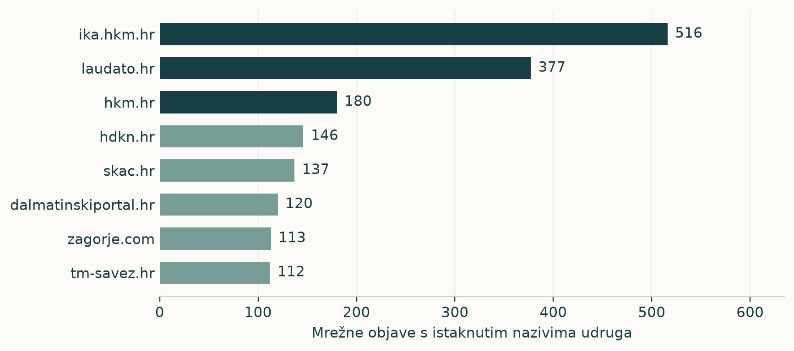
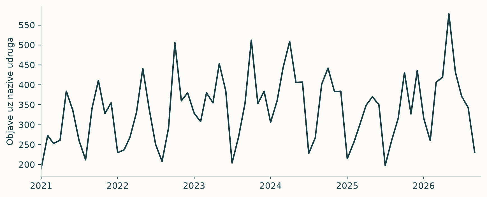
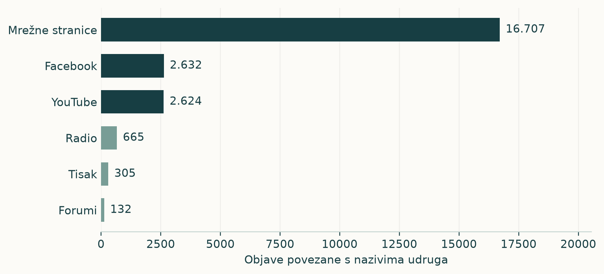
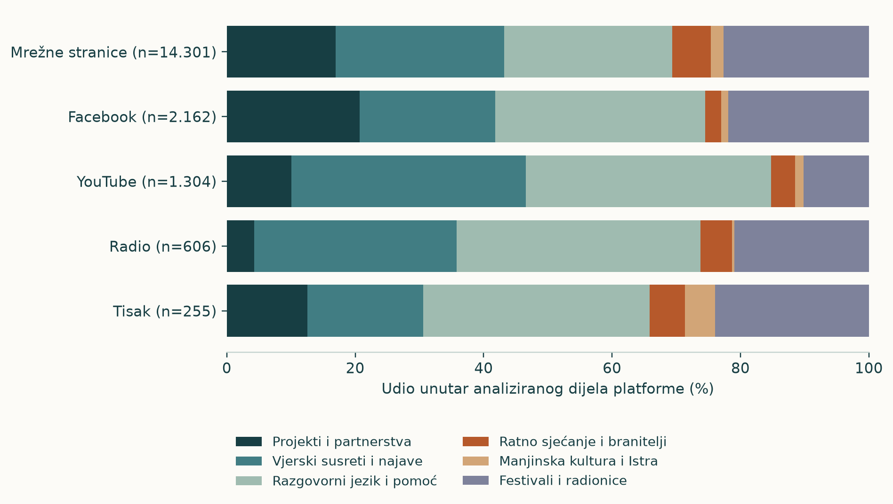

<!-- PAGE: Ključni nalazi | Javna prisutnost ima nekoliko prepoznatljivih središta -->

Udruge iz područja duhovnosti pojavljuju se u medijskom prostoru kroz duhovne programe, socijalnu podršku, stručne susrete, kulturne događaje i zaštitu okoliša. Pregled povezuje **1.325 udruga** iz nacionalnog popisa s **23.436 objava uz njihove nazive** od početka 2021. do 10. rujna 2026.

## SKAC Palma predvodi usporedbu istaknutih mrežnih spomena

U usporedbi mrežnih objava s nazivom u naslovu ili uvodu **SKAC Palma ima 390 objava**, a **Udruga slijepih Međimurske županije 352**. Slijede Moje mjesto pod suncem, Hrvatsko društvo katoličkih novinara i Hrvatsko katoličko liječničko društvo. Deset vodećih naziva okuplja **32,6%** veza naziva i objava u toj usporedbi.

## Medijski kanali otkrivaju različite javne krugove

SKAC Palma povezuje vlastitu stranicu s HKM-om, Laudatom i drugim katoličkim medijima. Udruga slijepih Međimurske županije snažno je prisutna u regionalnim medijima. Moje mjesto pod suncem najviše se pojavljuje na Novom listu, Torpedu i Tekliću. Ime dobrote izrazito je koncentrirano na Laudatu.

## Sadržaj objašnjava zašto se organizacija pojavljuje

Uz programe SKAC-a Palma ponavljaju se prijave, mladi i duhovne vježbe. Uz međimursku udrugu ističu se provedba programa i podrška slijepim osobama. Uz Moje mjesto pod suncem pojavljuju se djeca, siromaštvo i socijalno uključivanje. Broj objava dobiva značenje kada se poveže s tim sadržajem.

~ Izvještaj donosi pregled popisa i platformi, rang vodećih naziva, raspodjelu po medijima, vremenski prikaz i organizacijske portrete. Jezični izvještaj *Od riječi do javne uloge* detaljnije prikazuje riječi i teme istih organizacija.

<!-- PAGE: Pokazatelji | Od širine popisa do istaknutog mjesta u tekstu -->

Nacionalni popis obuhvaća udruge iz administrativnog područja duhovnosti u **21 županiji**. Među njima su organizacije koje se bave vjerom, kulturom, humanitarnim radom, podrškom zajednici i okolišem. Medijska slika odražava tu raznovrsnost aktivnosti.

| Pokazatelj | Rezultat i značenje |
|---|---|
| Udruge u nacionalnom popisu | 1.325 registriranih organizacija |
| Nazivi zastupljeni u medijskim objavama | 450 naziva |
| Objave povezane s nazivima iz popisa | 23.436 objava na svim platformama |
| Mrežne objave | 16.707, odnosno 71,3% ukupnog broja |
| Tekstualna analiza | 18.938 konteksta raspoređenih u šest tema |
| Istaknuti mrežni spomeni | 7.219 mrežnih objava uz 333 naziva |

Ukupni pregled broji objave prema platformi, adresi i datumu. U organizacijskoj usporedbi svaka mrežna adresa ulazi jednom po nazivu, a naziv se pojavljuje u naslovu ili prvih 800 znakova teksta. Usporedba tako izdvaja objave u kojima je organizacijski naziv istaknut već pri ulasku u sadržaj.

Jedna objava može uključiti nekoliko organizacija. Zato 7.219 mrežnih objava daje **7.283 veza naziva i objava**, na kojima se temelji rang.

~ Izvori: summary.json, platform_landscape.csv, topics.csv i organisation_method.json. Usporedba uključuje organizacijska imena i dokumentirane programske nazive, poput programa Moje mjesto pod suncem.

<!-- PAGE: Geografija | Zagreb okuplja gotovo trećinu registriranih udruga -->

U Gradu Zagrebu registrirane su **422 udruge**, odnosno **31,8%** popisa. Slijede Splitsko-dalmatinska i Primorsko-goranska županija. Glavni grad ima najgušću koncentraciju organizacijskih sjedišta, uz značajna regionalna središta na obali.

Na 100.000 stanovnika Zagreb ima **54,3 registrirana sjedišta**, a nacionalni omjer iznosi **34,2**. Pokazatelj povezuje organizacijsku mrežu s veličinom stanovništva.

Medijski portreti proširuju geografsku sliku. Zagreb je važan za SKAC Palmu te katolička strukovna društva. Međimurje okuplja velik dio objava o lokalnoj udruzi slijepih, a Rijeka o programu Moje mjesto pod suncem. Organizacijska sjedišta povezuju se s prepoznatljivim regionalnim medijskim krugovima.

~ Izvori: county_landscape.csv, county_population_adjusted.csv i procjena stanovništva DZS-a za sredinu 2025. Popis udruga datiran je 11. rujna 2026.

<!-- PAGE: Vodeći nazivi | Tko zauzima najviše prostora u mrežnim objavama? -->

Rang prema broju mrežnih objava s istaknutim nazivom predvode **SKAC Palma** i **Udruga slijepih Međimurske županije**. Slijede nazivi povezani sa socijalnim uključivanjem, katoličkim strukama, kulturom, okolišem i mladima.

| Naziv | Objave | Domene |
| --- | --- | --- |
| SKAC Palma | 390 | 26 |
| Udruga slijepih Međimurske županije | 352 | 26 |
| Moje mjesto pod suncem | 256 | 69 |
| Hrvatsko društvo katoličkih novinara | 251 | 30 |
| Hrvatsko katoličko liječničko društvo | 246 | 61 |
| Matica hrvatska u Jastrebarskom | 227 | 51 |
| Ime dobrote | 205 | 17 |
| Sunce | 180 | 63 |
| Alfa Albona | 139 | 13 |
| Humanitarna udruga fra Mladen Hrkać | 127 | 77 |

Deset vodećih naziva ukupno ima **2.373 veza s mrežnim objavama**, odnosno **32,6%** organizacijske usporedbe. Broj domena pokazuje širinu njihove prisutnosti. Udruga fra Mladen Hrkać pojavljuje se na 77 domena, a Ime dobrote na 17.

~ Broji se jedna mrežna adresa po nazivu, uz spomen u naslovu ili uvodu teksta. Domene uključuju medije, organizacijske i institucionalne stranice. Izvor: organisation_ranking.csv.

<!-- PAGE: Medijska središta | Katolički mediji povezuju velik broj organizacija -->

Među mrežnim stranicama s istaknutim nazivima udruga vode **IKA** i **Laudato**. Uz njih se pojavljuju organizacijske stranice i regionalni mediji. Takav sastav povezuje specijalizirani vjerski prostor s lokalnim vijestima i komunikacijom samih udruga.

IKA ujedinjuje vijesti o strukovnim društvima, duhovnim programima i kulturnim događajima. Laudato je osobito važan za Ime dobrote i SKAC Palmu. Regionalni portali povezuju aktivnosti s mjestima održavanja, korisnicima i lokalnim partnerima.

Organizacijske stranice, poput skac.hr i hdkn.hr, daju prostor izravnom predstavljanju rada. Njihova zastupljenost uz vanjske medije pokazuje kako se javna prisutnost gradi vlastitim objavljivanjem i pojavljivanjem na drugim stranicama.

~ Izvori: prominent_web_outlets.csv i organisation_outlets.csv. Grafikon prikazuje mrežni dio organizacijske usporedbe.

<!-- PAGE: Organizacije i mediji | Svaka vodeća organizacija ima svoj krug objavljivanja -->

Tri najzastupljenije domene sažimaju gdje se pojedini naziv najčešće susreće. Katoličke organizacije snažno se povezuju s vjerskim medijima, a lokalne udruge s regionalnim portalima i gradskim stranicama.

| Naziv | Tri najzastupljenije domene (broj objava) |
| --- | --- |
| SKAC Palma | skac.hr (137); hkm.hr (55); laudato.hr (51) |
| Udruga slijepih Međimurske županije | medjimurjepress.net (56); muralist.hr (52); radio1.hr (34) |
| Moje mjesto pod suncem | novilist.hr (36); torpedo.media (28); teklic.hr (17) |
| Hrvatsko društvo katoličkih novinara | hdkn.hr (146); ika.hkm.hr (57); laudato.hr (7) |
| Hrvatsko katoličko liječničko društvo | hkld.hr (101); ika.hkm.hr (46); biskupija-varazdinska.hr (7) |
| Matica hrvatska u Jastrebarskom | matica.hr (62); jaskadanas.hr (35); jastrebarsko.hr (22) |
| Ime dobrote | laudato.hr (182); vecernji.hr (5); dalmatinskiportal.hr (2) |
| Sunce | dalmatinskiportal.hr (22); dalmacijadanas.hr (14); morski.hr (13) |
| Alfa Albona | alfa-albona.hr (36); 5portal.hr (30); radiolabin.hr (20) |
| Humanitarna udruga fra Mladen Hrkać | obican.info (9); hkm.hr (5); ika.hkm.hr (5) |

Najizraženiju koncentraciju ima **Ime dobrote**: Laudato donosi **88,8%** njegovih objava u ovoj usporedbi. Kod **udruge fra Mladen Hrkać** najveća domena čini **7,1%**, uz 77 domena ukupno. To su dva oblika distribucije: snažno središte i široko raspršena mreža.

~ Brojevi u zagradama označuju mrežne objave uz pojedini naziv. Izvor: organisation_outlets.csv.

<!-- PAGE: Vrijeme | Objave prate višegodišnju prisutnost i programske povode -->

Od **1. siječnja 2021. do 10. rujna 2026.** zabilježeno je 23.436 objava povezanih s nazivima iz popisa. Najveći godišnji broj u pregledu ima 2024., s **4.538 objava**. Mjesečni prikaz pokazuje raspored objavljivanja tijekom cijelog razdoblja.

| Godina | Broj objava |
|---|---:|
| 2021 | 3.605 |
| 2022 | 3.843 |
| 2023 | 4.286 |
| 2024 | 4.538 |
| 2025 | 3.807 |
| 2026. do 10. rujna | 3.357 |

Programi, prijave, obljetnice, radionice i humanitarne kampanje stvaraju povode za objave. **38 naziva** pojavljuje se u najmanje 37 mjeseci, a još **93** u 13 do 36 mjeseci. Uz ponavljanu prisutnost postoji i velik broj naziva vezanih uz kraće programske epizode.

~ Izvori: annual_landscape.csv, monthly_landscape.csv i persistence.csv. Razdoblje za 2026. završava 10. rujna.

<!-- PAGE: Platforme | Mrežne stranice nose najveći dio objava -->

Mrežne stranice donose **16.707 objava**, odnosno **71,3%** ukupnog pregleda. Facebook ima **2.632**, a YouTube **2.624** objave. Slijede radio, tisak i forumi. Središte objavljivanja čine mrežni članci, uz dodatne prostore društvenih mreža i emisija.

Mrežni sadržaji povezuju vijesti, najave, pozive i izvještaje o aktivnostima. Facebook omogućuje kratke obavijesti i predstavljanje događaja. YouTube otvara prostor programima, razgovorima i predstavljanju gostiju. Organizacija tako može biti prisutna kroz više formata javnog djelovanja.

U opisu emisije uz **Korablju** pojavljuje se pitanje uključivanja osoba s invaliditetom. Uz **SKAC Palmu** mrežne najave donose termine duhovnih programa. Platforma i povod zajedno određuju oblik u kojem javnost susreće organizaciju.

~ Izvor: platform_landscape.csv; organizacijski primjeri C3 i C4 iz arhivirane građe.

<!-- PAGE: Tematska karta | Susreti, projekti i radionice oblikuju javni sadržaj -->

Tekstualna analiza **18.938 konteksta** izdvaja šest tematskih skupina. Najveća je razgovorni jezik i pomoć s **28,7%**, zatim vjerski susreti i najave s **26,0%** te festivali i radionice s **21,7%**. Projekti i partnerstva čine **16,3%**.

Na mrežnim stranicama snažno su zastupljeni vjerski susreti, razgovorni sadržaj i lokalni programi. YouTube i radio ističu susrete i razgovor, a Facebook povezuje programske najave, projekte i osobniji jezik.

Kod pojedinih organizacija profili se jasnije razdvajaju. Međimurska udruga slijepih povezana je s projektima i partnerstvima, katolička strukovna društva sa susretima i najavama, a Alfa Albona s festivalima i radionicama. Sljedeći portreti povezuju te obrasce s konkretnim sadržajem.

~ Izvori: topics.csv, repeat_check_channels.csv i organisation_topics.csv. Tema označuje najizraženiju rječničku skupinu u analiziranom kontekstu.

<!-- PAGE: Portret / SKAC Palma | Duhovni program postaje poziv na sudjelovanje -->

**SKAC Palma** ima **390 mrežnih objava** na **26 domena**. Najviše ih je na **skac.hr (137); hkm.hr (55); laudato.hr (51)**. Vlastita stranica i katolički mediji zajedno čine glavni prostor predstavljanja programa.

## Riječi povezuju publiku, program i prijavu

U 383 tekstualno analizirane objave riječ **mlade** pojavljuje se u **109**, **prijave** u **75**, a **duhovne** u **71**. Rječnik opisuje komunikaciju koja se obraća budućim sudionicima i daje im razlog i način uključivanja.

Objava HKM-a iz siječnja 2021. predstavlja vikend pokore kroz termine, opis duhovne prakse i iskustvo sudionice. Najava iz svibnja iste godine ističe ljetne kampove za mlade. U siječnju 2024. pojavljuju se pozivi na korizmene programe. Ponavljaju se program, osobno iskustvo i prijava.

| Sastavnica javne prisutnosti | Sadržaj |
|---|---|
| Organizacijska stranica | Programi i obraćanje sudionicima |
| Katolički mediji | Najave, iskustva i predstavljanje aktivnosti |
| Prepoznatljiv rječnik | Mladi, prijave, duhovne vježbe i program |

Tematska skupina razgovornog jezika i pomoći obuhvaća **71,8%** analiziranih konteksta. Uz programske informacije, javnu sliku SKAC-a Palma snažno oblikuje jezik iskustva i osobnog obraćanja.

~ Izvori: organisation_ranking.csv, organisation_outlets.csv, organisation_words.csv i organisation_topics.csv; arhivirani tekstovi HKM-a iz 2021. i 2024.

<!-- PAGE: Portret / socijalna podrška | Međimurska udruga povezuje projekte sa svakodnevnim potrebama -->

**Udruga slijepih Međimurske županije** ima **352 mrežne objave** na **26 domena**. Vode **medjimurjepress.net (56); muralist.hr (52); radio1.hr (34)**. Regionalni mediji čine prepoznatljivu mrežu oko programa podrške i lokalnih korisnika.

## Projekti daju kontinuitet objavljivanju

Skupina **projekti i partnerstva** obuhvaća **311 od 351** analizirane objave, odnosno **88,6%**. Riječ **aktivnosti** javlja se u **109**, **provodi** u **106**, a **projekta** u **91** objava.

Objave iz 2021. donose poziv volonterima u programu *Osjetimo život*, iskustvo pomoćnice u nastavi i radionicu osnaživanja slijepih žena. U 2024. pojavljuju se višegodišnji program kvalitetnijeg života i radionice podrške samostalnosti mladih članova. Organizacija se predstavlja kroz redovite usluge i konkretne oblike podrške.

| Područje sadržaja | Javna uloga udruge |
|---|---|
| Volontiranje i radionice | Okuplja ljude oko praktične podrške. |
| Pomoć u nastavi | Povezuje socijalnu podršku i obrazovanje. |
| Samostalnost mladih članova | Predstavlja aktivnosti svakodnevnog života. |

Profil povezuje visoku učestalost objava s jasnim programskim sadržajem. Udruga je prisutna kao provoditelj aktivnosti, sugovornik o potrebama korisnika i sudionik lokalne zajednice.

~ Izvori: organizacijske tablice; arhivirani tekstovi Regionalnog, Muralista i Međimurskog iz 2021. i 2024.

<!-- PAGE: Portreti / katoličke struke | Novinarsko i liječničko društvo povezuju struku i vjerski život -->

**Hrvatsko društvo katoličkih novinara** ima **251 objavu** na **30 domena**, a **Hrvatsko katoličko liječničko društvo 246** na **61 domeni**. Oba povezuju vlastite stranice s IKA-om i drugim katoličkim izvorima.

| Organizacija | Tri najzastupljenije domene |
|---|---|
| Katolički novinari | hdkn.hr (146); ika.hkm.hr (57); laudato.hr (7) |
| Katolički liječnici | hkld.hr (101); ika.hkm.hr (46); biskupija-varazdinska.hr (7) |

Kod novinarskog društva **58,2%** objava nalazi se na hdkn.hr, a kod liječničkog **41,1%** na hkld.hr. Vlastito objavljivanje važan je sastavni dio njihova javnog djelovanja.

## Susreti i stručna zajednica u prvom su planu

Vjerski susreti i najave čine **89,6%** analiziranih konteksta novinarskog i **91,9%** liječničkog društva. U prvome se ističu riječi o društvenim komunikacijama, a u drugome podružnice, život i susreti.

U tekstovima o liječničkom društvu nalaze se blagdan sv. Luke, tribina povodom Dana života i obljetnica karlovačke podružnice. Novinarsko društvo objavljuje o članovima, crkvenim događajima i komunikacijskim temama. Strukovna pripadnost povezuje se s vjerskim kalendarom i javnim pitanjima.

~ Izvori: organisation_outlets.csv, organisation_topics.csv i organisation_words.csv; arhivirani tekstovi IKA-e i hdkn.hr.

<!-- PAGE: Portreti / uključivanje i pomoć | Od riječkog programa do široke humanitarne mreže -->

**Moje mjesto pod suncem** pojavljuje se u **256 mrežnih objava** na **69 domena**. Predvode **novilist.hr (36); torpedo.media (28); teklic.hr (17)**. Organizacijski i programski naziv povezuje se s Rijekom, djecom i socijalnim uključivanjem.

U **255** analiziranih konteksta riječ **siromaštva** javlja se u **119**, **program** u **102**, a **djece** u **84**. Kampanja iz 2021. predstavlja uređenje prostora za uključivanje djece i obitelji. Objave iz 2024. povezuju program sa sportskom manifestacijom i iskustvima djece.

## Ime dobrote ima snažno medijsko središte

Uz **Ime dobrote** zabilježeno je **205 objava**, od kojih **182 na Laudatu**. Program *Progledaj srcem online* povezuje umjetnost, kulturu i aktivnosti za djecu i mlade. Uz taj program u tekstovima se pojavljuju i liturgijski sadržaji.

## Udruga fra Mladen Hrkać pojavljuje se na brojnim domenama

Uz ovu humanitarnu udrugu pronađeno je **127 objava** na **77 domena**. Vode **obican.info (9); hkm.hr (5); ika.hkm.hr (5)**. Najzastupljenija domena ima 9 objava. Projekti i partnerstva čine **45,7%** analiziranih konteksta.

Tri profila povezuju pomoć i uključivanje s različitim načinima pojavljivanja: regionalnom mrežom, snažnim specijaliziranim medijem i velikim brojem pojedinačnih kanala.

~ Izvori: organizacijske tablice; arhivirani tekstovi o programima Moje mjesto pod suncem i Progledaj srcem online.

<!-- PAGE: Portreti / kultura i okoliš | Programi otvaraju prostor izvan izravno vjerskih tema -->

**Matica hrvatska u Jastrebarskom** ima **227 objava** na **51 domeni**. Vode **matica.hr (62); jaskadanas.hr (35); jastrebarsko.hr (22)**. Riječi *program*, *poetsko* i *glazbeni* povezuju je s kulturnim događajima i lokalnom baštinom. Božićni poetsko-glazbeni program pokazuje spoj kulturnog i vjerskog kalendara.

## Sunce: okoliš, javne akcije i projektni jezik

Uz **Sunce** zabilježeno je **180 objava** na **63 domene**. Vode **dalmatinskiportal.hr (22); dalmacijadanas.hr (14); morski.hr (13)**. Projekti i partnerstva čine **38,9%**, a festivali i radionice **37,8%** analiziranih konteksta. Ponavljaju se riječi *otpada*, *mora*, *projekta* i *organizira*. U objavama se prepoznaju očuvanje Jadrana i pozivi na akcije čišćenja.

## Alfa Albona: mladi i mogućnosti sudjelovanja

**Alfa Albona** ima **139 objava** na **13 domena**. Vode **alfa-albona.hr (36); 5portal.hr (30); radiolabin.hr (20)**. Festivali i radionice čine **48,2%**, a projekti i partnerstva **41,0%** analiziranih konteksta. Objave o kampanji *Time to Move* predstavljaju informacije i aktivnosti namijenjene mladima.

Ovi profili pokazuju raznolikost područja duhovnosti u registru. U medijskom sadržaju organizacije dobivaju konkretno mjesto kroz kulturno stvaralaštvo, zaštitu zajedničkog prostora i programe za mlade.

~ Izvori: organizacijske tablice; arhivirani tekstovi Matice hrvatske te medija o aktivnostima Sunca i Alfa Albone.

<!-- PAGE: Javni glasovi i izvori | Aktivnosti i kanali zajedno objašnjavaju javnu prisutnost -->

Organizacijska usporedba otkriva nekoliko obrazaca. SKAC Palma povezuje program i osobno iskustvo. Međimurska udruga slijepih gradi prisutnost kroz usluge. Katolička strukovna društva povezuju profesiju i vjerske susrete. Moje mjesto pod suncem donosi jezik socijalnog uključivanja, a kulturne i okolišne udruge programske i lokalne teme.

## Javna prisutnost ostvaruje se različitim glasovima

Izvještaj SKAC-a Split o pomoći nakon potresa prikazuje rad volontera kroz raspodjelu donacija i pomoć obiteljima. Splitv-portal prenosi tekst i fotografije organizacije. Korablja se u opisu emisije *Argumenti* pojavljuje kroz goste povezane s temom invaliditeta. Kršćanski akademski krug prisutan je kroz časopis *Nova prisutnost* i predstavljanje njegova intelektualnog i društvenog sadržaja.

Broj objava opisuje učestalost pojavljivanja. Raspodjela po domenama pokazuje gdje se organizacija susreće s javnošću. Riječi, teme i primjeri objašnjavaju što u tom prostoru predstavlja. Zajedno daju sadržajan pregled organizacijskog djelovanja u medijima.

## Izvori pokazatelja

Popis udruga: dostavljeni PDF i JSON od 11. rujna 2026. Medijske objave: DetermDB, od 1. siječnja 2021. do 10. rujna 2026. Geografski kontekst: DZS, procjena stanovništva sredinom 2025. Organizacijske usporedbe, riječi i teme: tablice organisation_ranking, organisation_outlets, organisation_words i organisation_topics.

~ Arhivirani tekstovi i poveznice čuvaju se u istraživačkoj građi DigiKata. Postupak izračuna nalazi se u reader-reports/README.md. Priprema i grafička obrada uz pomoć umjetne inteligencije. Izdanje: 22. rujna 2026.
